# clawd copilot

<p align="center"></p>

A copilot for your coding agent.

<!-- demo: a short GIF of copilot tail and the agent answering goes here (assets/demo.gif) -->

copilot gives your coding agent a live transcript of what it hears: your mic and your call. An AI note-taker answers after the meeting. Your agent answers during it, in its own chat, or out loud if you ask.

Use it in a design review, while you walk someone through a change to a site, or in any meeting. Say its name, and it picks up the question before you finish the sentence.

For example:

- "Clawd, what did we just agree to?"
- "Clawd, make that button bigger."
- "Clawd, have a sub-agent scope that build while we keep talking."

## How to get started

1. Tell your coding agent: "Set up github.com/smithavt14/meeting-copilot for me." It follows [AGENTS.md](AGENTS.md) and does the install.
2. Pick a wake name. It is "Claude" by default. Tell your agent the name you want (Jarvis, Clawd, your agent's own name) and it saves it as `name` in your `copilot.toml`.
3. On a Mac, click Allow when it asks for the microphone, and turn on system audio recording for your terminal. You click those two; the agent does the rest.
4. Say "Let's start a copilot session."
5. Tell the room, then talk. Start a sentence with your wake name whenever you want it.

**Disk space:** the local models take about 840 MB (Parakeet 490 MB, Kokoro 350 MB, the Silero VAD 2 MB). To skip the big two, tell your agent to use hosted models: `transcribe = "cloud"` sends speech to OpenRouter with your `OPENROUTER_API_KEY`, and `voice = "system"` (or ElevenLabs with `ELEVENLABS_API_KEY`) speaks without Kokoro. Then only the 2 MB VAD model downloads.

## How it works

copilot listens to two audio streams, your microphone (`me`) and the computer's audio (`call`), cuts them into utterances, transcribes them, and appends numbered lines to a JSONL file. Your agent reads those lines with `copilot wake` and answers in text when someone says "Claude, ...", or out loud through `copilot say` when you ask it to. Nothing joins the call. It runs on macOS and Windows; the Windows path is untested so far.

```
mic ──────────────┐
                  ├─ Silero VAD ─ transcribe (drafts, then a final) ─ echo backstop ─ lines.jsonl ─ copilot wake ─ Claude Code
app or loopback ──┘
```

## Install by hand

Coding agents setting this up for someone: follow [AGENTS.md](AGENTS.md).

You need [uv](https://docs.astral.sh/uv/) and git. uv installs the pinned Python (3.12) by itself; the speech and VAD wheels are not built for the newest Python releases yet.

```sh
git clone https://github.com/smithavt14/meeting-copilot.git
cd meeting-copilot
uv tool install --python 3.12 --editable .
copilot download
```

`uv tool install` puts `copilot` in `~/.local/bin` (run `uv tool update-shell` once if that is not on your PATH). `copilot download` fetches the Silero VAD model (2 MB), Parakeet TDT v3 (about 490 MB) and Kokoro (about 350 MB, for `copilot say`) into your user cache directory; without it, the first `copilot listen` or `copilot say` fetches what it needs. If you would rather not install the command, run `uv sync` and use `uv run copilot ...` from the repo.

### macOS: the call's audio

The call's audio comes from a Core Audio process tap in a small Swift binary, `tap`. It needs macOS 14.4 or newer and the Xcode command line tools (`xcode-select --install`). Build it once:

```sh
scripts/build-tap.sh
```

Two permissions, both for the app you run `copilot` from (Terminal, iTerm, Ghostty, or the app hosting your Claude Code session):

- **Microphone**: macOS asks the first time `copilot listen` opens the mic.
- **System audio recording**: System Settings > Privacy & Security > Screen & System Audio Recording, under "System Audio Recording Only", turn on the terminal app. macOS may ask on the first tap instead. Without it the tap delivers silence, and `copilot listen` says it has heard no audio from the tap after 15 seconds.

`tap/build/tap --list` shows the processes Core Audio knows about, and which are playing.

### Windows (untested)

No extra build step: the call's audio is WASAPI loopback through PyAudioWPatch, installed with the rest. Loopback hears **everything** the default speakers play, including notifications and music, so mute other apps during a call. Capturing a single app is a later step. Nobody has run this path on a Windows machine yet; reports welcome.

## Use

```sh
copilot listen --app "Google Chrome"   # macOS: your mic plus Chrome's audio (Google Meet); also zoom.us, "Microsoft Teams", a bundle id
copilot listen --loopback              # Windows: your mic plus everything the speakers play
copilot listen                         # in person: the mic only
copilot listen --diarize               # in person, with each voice in the room labelled s1, s2, ...
copilot name s2 Joe                    # show s2 as Joe in tail, wake and transcript
copilot transcript                     # print a run's lines, with names and the end-of-run labels
copilot tail                           # in another terminal: watch the lines land, with the open drafts underneath
copilot say "Two hundred and twelve."  # speak an answer aloud (the skill runs this when you ask)
copilot mute                           # stop writing lines until "Claude, unmute" or copilot unmute
copilot stop                           # from any other shell: stop the running listen cleanly (or Ctrl-C)
```

Each finished line prints as it lands (`[12 14:03:21] call: ...`), and the run's directory is printed at the start. `copilot tail` follows the current run from any terminal: final lines as `[12] call: ...`, and on a terminal the open drafts on one line underneath, speakers in two colours and drafts dimmed (set `NO_COLOR` to turn colour off). It exits when the run stops. Other flags: `--no-mic`, `--mic-device <name or index>`, `--name <wake name>`, `--transcribe local|cloud`, `--draft-ms <ms>`. `copilot listen --help` lists them all.

**In a room**, everyone comes through the mic, so every line reads `me`. Add `--diarize` and the mic's lines are labelled by voice instead (`s1`, `s2`, ...), with one label per line. It downloads a 40 MB speaker model once; how it labels, and how accurate it is, is in [docs/usage.md](docs/usage.md#speakers-in-a-room).

**Wear headphones.** On laptop speakers the mic hears the call, and call lines come back as `me` lines. A backstop drops a `me` line that mostly repeats a `call` line from the last few seconds, but some will slip through.

Mute, voice, local or cloud transcription, speakers in a room, drafts, the output file, `wake` and every setting are in [docs/usage.md](docs/usage.md).

## The agent skill

`skills/meeting-copilot/SKILL.md` teaches a coding agent to run a meeting: Claude Code, Codex, Cursor or any other agent with a shell. Say "copilot this meeting" or "let's start a copilot session" and it starts `copilot listen` in the background, opens `copilot tail` where you can watch it (or gives you the command), runs `wake` in a loop, answers "Claude, ..." questions in text, fact-checks, scopes ideas, stays quiet otherwise, and stops the run when you say "stop the meeting". Claude Code and Codex load it on their own in this repo.

If your agent did the setup, the skill is already installed: AGENTS.md step 8 links it in for that agent. To install it yourself, or for more agents:

```sh
npx skills add smithavt14/meeting-copilot
```

That asks which agents to install it for. Or link it by hand, from the repo root:

```sh
mkdir -p ~/.claude/skills ~/.agents/skills
ln -s "$PWD/skills/meeting-copilot" ~/.claude/skills/meeting-copilot   # Claude Code
ln -s "$PWD/skills/meeting-copilot" ~/.agents/skills/meeting-copilot   # Codex and other agents
```

(On Windows, copy the folder into `%USERPROFILE%\.claude\skills\` or `%USERPROFILE%\.agents\skills\` instead.)

The wake name defaults to "Claude". If you run it from another agent and would rather say its name, set `name = "Codex"` (or any name) in `copilot.toml`. The built-in mishearings ("cloud", "claw", "call") only count for "Claude"; give another name its own with `variants`.

## Test without a meeting

`copilot listen --file <wav>` plays a WAV file through the same VAD, transcription and echo path, at real time (`--speed 0` for as fast as possible), as the `call` stream (`--as me` for the mic stream).

```sh
uv run python scripts/make_sample.py sample.wav   # macOS: invented sentences spoken by `say`
copilot listen --file sample.wav
uv run pytest
```

## License

MIT. See [LICENSE](LICENSE).

## Hey, read this before you record

**Get consent.** This tool records and transcribes everyone it hears. Tell the room, and the people on the call, before you start it. Many places (including several US states and much of Europe) require every party's consent to record a conversation; check the rules where you and the other people are.
